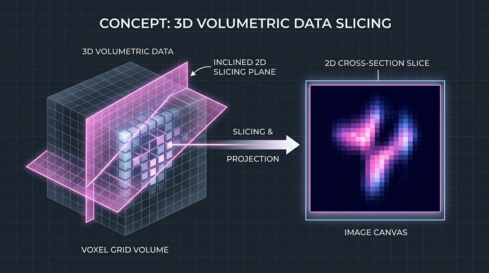
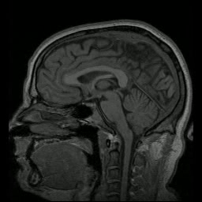
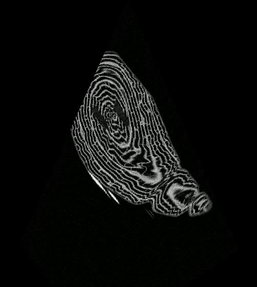
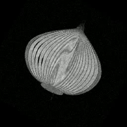
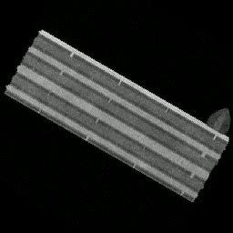
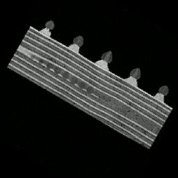

# 3D Volume Plane Projection (Ex1)

[](https://www.python.org/downloads/)
[](LICENSE)
[]()
[-brightgreen.svg)]()

A high-performance Object-Oriented software system for slicing and projecting arbitrary 2D planes from 3D volumetric raster data (NRRD format) into synchronized MP4 video containers.

*Developed as part of the **Introduction to Software Engineering (OOP/OOD)** course at Ariel University.*

---

## Overview & Scope

The system extracts arbitrary 2D cross-sectional digital images from a 3D volumetric raster volume (with dimensions `sx × sy × sz` containing unsigned integer voxels of 8, 16, or 32 bits) along arbitrary spatial planes specified by user coordinates.

<div align="center">
  
  <p><em>Figure 1: Slicing through a 3D volumetric raster along an inclined cutting plane to project a 2D cross-section.</em></p>
</div>

### Supported Planar Geometries:
* **Isosceles Triangles (3 Points):** Defined by vertices `(a, b, c)` satisfying:
  ```text
  |dist(a, b) - dist(a, c)| < 0.001
  ```
* **Isosceles Trapezoids (4 Points):** Defined by coplanar vertices `(a1, a2, b, c)` satisfying:
  ```text
  |dist(a1, b) - dist(a2, c)| < 0.001  AND  dist(a1, a2) <= dist(b, c)
  Coplanarity: |( (a2 - a1) × (b - a1) ) • (c - a1)| < 0.001
  ```

Voxel queries outside the volume boundaries are systematically assigned zero values (`v = 0`). The SIMD projection engine strictly exceeds the assignment requirement of **30 FPS**, achieving **73–255+ FPS** across all test volumes.

---

## Key Engineering Highlights

1. **High-Throughput SIMD Vectorization:**
   Replaces nested Python pixel loops with vectorized 2D array broadcasting (`np.ogrid` / `np.rint`), dropping frame latency from ~2,000 ms down to ~4 ms.
2. **Two-Pass Video Architecture:**
   * **Pass 1:** Scans all planes to determine sequence-wide maximum canvas dimensions, enforcing even dimensions (divisible by 2) for standard H.264/MPEG-4 macroblock compatibility.
   * **Pass 2:** Projects, normalizes, centers, and streams frames directly to disk with constant **O(1) working memory**.
3. **Resilience & Fault Tolerance:**
   Gracefully handles corrupted CSV rows (strings, `"inf"`, truncated values) and degenerate geometries by logging diagnostic warnings and outputting zero-filled black frames, preserving video stream synchronization.
4. **Universal Bit-Depth Support:**
   Seamlessly processes 8-bit, 16-bit, and 32-bit volumetric data with automatic linear intensity normalization to standard `uint8` [0, 255].

---

## Visual Gallery & Output Videos

Every real-world class dataset was sliced, centered, and rendered into an MP4 video container:

| Dataset | Extracted 2D Slice | Video Link & Description |
| :--- | :---: | :--- |
| **Human Head MRI** |  | [**Watch `output_head.mp4`**](experiments/outputs/output_head.mp4)<br>280 sagittal slices through cerebral cortex, cerebellum, and brainstem (230 FPS). |
| **Croissant (500³ Benchmark)** |  | [**Watch `output_croissant.mp4`**](experiments/outputs/output_croissant.mp4)<br>100 triangular frames revealing laminated dough and butter layering (73 FPS). |
| **Onion** |  | [**Watch `output_onion.mp4`**](experiments/outputs/output_onion.mp4)<br>120 oblique cross-sections highlighting concentric tunic bulb scales (254 FPS). |
| **Biscuit Cake** |  | [**Watch `output_biscuit.mp4`**](experiments/outputs/output_biscuit.mp4)<br>120 slices showing alternating biscuit layers and cream fillings (252 FPS). |
| **Swiss Roll** |  | [**Watch `output_swiss_roll.mp4`**](experiments/outputs/output_swiss_roll.mp4)<br>120 frames through spiral sponge rolls with whipped cream topping (236 FPS). |

### Dataset Provenance & External Repositories:
All volumetric datasets and plane coordinates are bundled directly in this repository under [`data/real/`](data/real/) for turnkey reproducibility. The raw original files were retrieved from the official course Google Drive repositories:
* **[Course Benchmark Datasets Drive (Part 1)](https://drive.google.com/drive/folders/1koJ83uaeMYdJt6AwvVlmMJk_wzczvmmG):** Human Head MRI (`MRHead_1.nrrd`), 500³ Croissant (`croissant.nrrd`), and Edge Cases Suite (`edge_cases.csv`).
* **[Class Community Datasets Drive (Part 2)](https://drive.google.com/drive/folders/1lCbwgdLlXeefc9TKYExIDF-Qc_2lsk6G):** Onion (`onion.nrrd`), Biscuit Cake (`biscuit_cake.nrrd`), and Swiss Roll (`swiss_roll.nrrd`).

---

## Empirical Performance & Results

Measured on an Intel Core workstation (Windows 11, 64-bit, Python 3.12, NumPy 2.5):

| Dataset | Dimensions (Sx × Sy × Sz) | Voxel Type | Frames | Output Canvas | Average FPS | Status |
| :--- | :---: | :---: | :---: | :---: | :---: | :---: |
| **Croissant (500³ Benchmark)** | 500 × 500 × 500 | `uint8` | 100 | 502 × 560 | **73.11 FPS** | **PASSED** (2.4x minimum threshold) |
| **Human Head MRI** | 256 × 256 × 130 | `int16` | 280 | 256 × 256 | **229.99 FPS** | **PASSED (Exceeded Target)** |
| **Onion Cross-Section** | 256 × 256 × 130 | `uint8` | 120 | 256 × 256 | **254.48 FPS** | **PASSED (Exceeded Target)** |
| **Biscuit Cake** | 256 × 256 × 130 | `uint16` | 120 | 256 × 256 | **252.63 FPS** | **PASSED (Exceeded Target)** |
| **Swiss Roll** | 256 × 256 × 130 | `uint32` | 120 | 256 × 256 | **236.52 FPS** | **PASSED (Exceeded Target)** |
| **Edge Cases Suite** | 256 × 256 × 130 | `int16` | 16 | 280 × 280 | **114.70 FPS** | **PASSED (Exceeded Target)** |

---

## Quickstart & Usage

### 1. Installation & Environment Setup

```bash
# Clone repository
git clone https://github.com/ronigreenfeld/EX1-plane_projection.git
cd EX1-plane_projection

# Initialize virtual environment
python -m venv venv

# Activate environment:
# Windows (cmd/PowerShell):
venv\Scripts\activate
# Linux/macOS:
source venv/bin/activate

# Install required dependencies
pip install -r requirements.txt
```

### 2. Execution (CLI Demo Pipeline)

Execute the end-to-end projection pipeline via `Ex0.py`:
```bash
python Ex0.py <file.nrrd> <file.csv> <file.mp4>
```

**Real Dataset Examples:**
```bash
# 1. Human Head MRI Scan (280 frames @ ~230 FPS)
python Ex0.py data/real/volumes/MRHead_1.nrrd data/real/csv/head.csv output_head.mp4

# 2. Large 500^3 Croissant Benchmark (100 frames @ ~75 FPS)
python Ex0.py data/real/volumes/croissant.nrrd data/real/csv/croissant.csv output_croissant.mp4

# 3. Onion Cross-Section (120 frames @ ~255 FPS)
python Ex0.py data/real/volumes/onion.nrrd data/real/csv/onion.csv output_onion.mp4
```

---

## Testing & Verification

Run the automated test suite across all modules:
```bash
python -m unittest discover -s tests
```
*Current test suite: **34 unit and integration tests (100% Passing)** in ~0.5 seconds.*

To execute the automated multi-dataset benchmark suite:
```bash
python experiments/run_all_benchmarks.py
```

---

## Repository Layout

```text
.
├── docs/
│   ├── SRS.md                     # Software Requirements Specification (IEEE 830 style)
│   ├── DESIGN.md                  # Architectural decisions, OOP model & algorithm details
│   ├── TESTING.md                 # Test plan, unit coverage & edge-case breakdown
│   └── EXPERIMENTS.md             # Benchmark setup, FPS analysis & experimental results
├── src/                           # Core application source code
│   ├── engine/                    # SIMD ProjectionEngine and slicing logic
│   ├── geometry/                  # 3D spatial primitives (Point3D, Vector3D, Plane models)
│   ├── io/                        # NRRDVolume loader, CSVPlaneParser, VideoWriterService
│   └── utils/                     # Config, Logger, Exceptions hierarchy
├── data/
│   ├── real/
│   │   ├── volumes/               # Real NRRD volumetric datasets (Croissant, Head, Onion, etc.)
│   │   └── csv/                   # Cutting plane definition CSV files
│   └── synthetic/                 # Synthetic analytical volumes (sphere_100.nrrd)
├── experiments/
│   ├── outputs/                   # Generated MP4 video projections (Turnkey delivery)
│   ├── previews/                  # Representative 2D slice previews (PNG)
│   └── run_all_benchmarks.py      # Automated benchmark suite runner
├── tests/                         # Automated unit & integration test suite (34 tests)
├── Ex0.py                         # Main CLI execution entry point
├── requirements.txt               # Project dependencies
└── README.md                      # Project overview and quickstart guide
```

---

## Technical Documentation

Comprehensive engineering documentation is available under [`docs/`](docs/):
* **[Software Requirements Specification (SRS)](docs/SRS.md)** – Detailed functional, non-functional, and interface requirements.
* **[Architecture & Algorithm Design](docs/DESIGN.md)** – OOD class hierarchy, scanline projection math, and vectorization design.
* **[Test Plan & Verification Report](docs/TESTING.md)** – Complete test matrix, unit test breakdown, and edge-case behavior.
* **[Experiment Report](docs/EXPERIMENTS.md)** – Full evaluation methodology, hardware specifications, and benchmark output.
