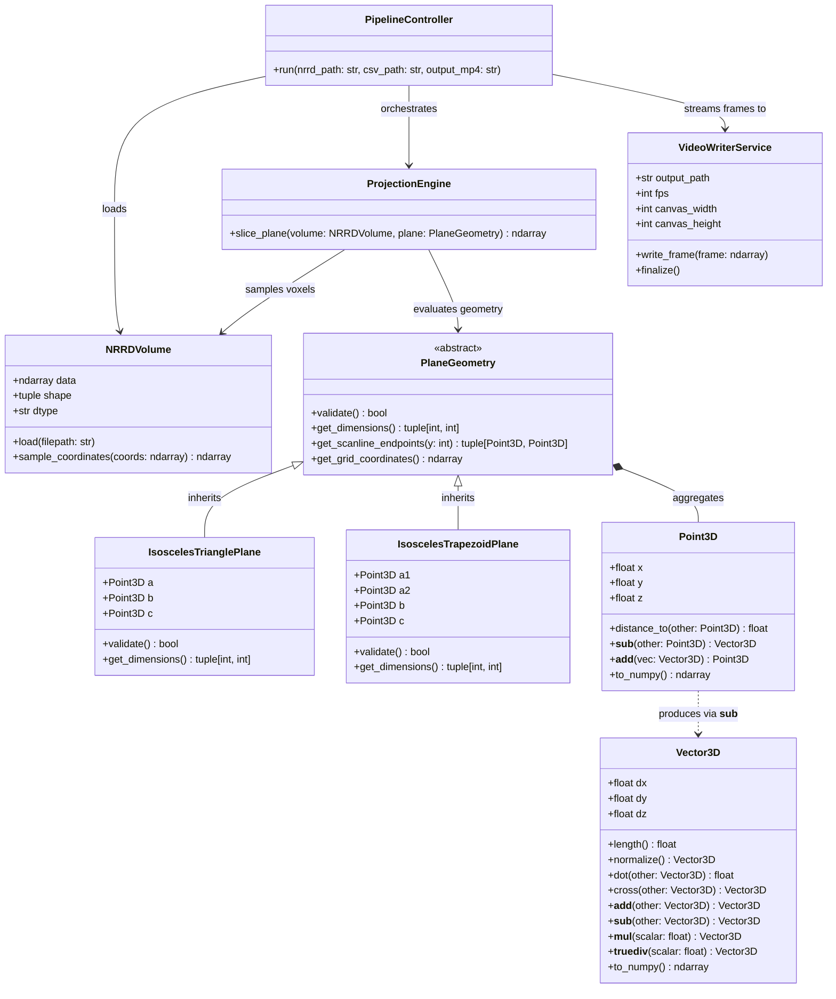
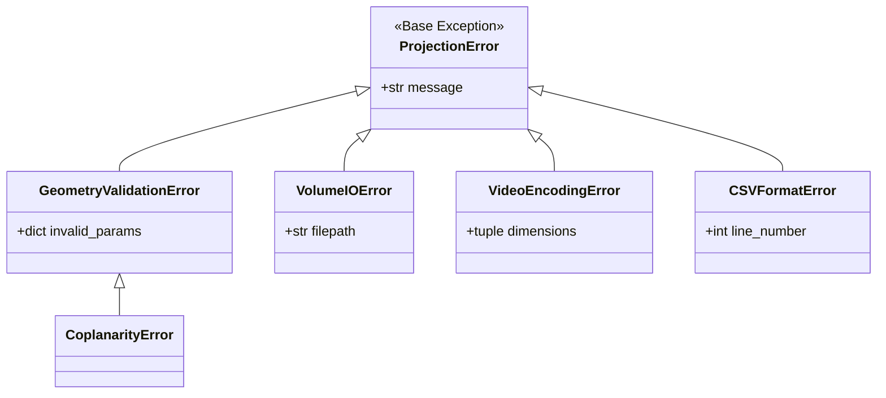
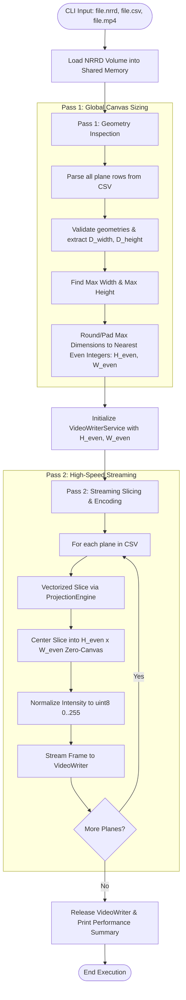

# Architecture & Algorithm Design Document

## Project: 3D Volume Plane Projection (Ex1)

---

## 1. Architectural Overview & Design Philosophy

The 3D Volume Plane Projection Engine is architected around modern **Object-Oriented Design (OOD)** and **SOLID** principles, balancing clean software design with extreme computational efficiency.

### Key Principles Applied:
* **Single Responsibility Principle (SRP):** Each class encapsulates a single concern — geometric primitives (`Point3D`, `Vector3D`), geometric validation (`PlaneGeometry`), volumetric storage (`NRRDVolume`), algorithmic slicing (`ProjectionEngine`), and media generation (`VideoWriterService`).
* **Open/Closed Principle (OCP):** Slicing abstractions operate against the abstract base class `PlaneGeometry`. Supporting future geometry types (e.g., circular discs or arbitrary polygons) requires no modifications to the projection engine.
* **Liskov Substitution Principle (LSP):** Both `IsoscelesTrianglePlane` and `IsoscelesTrapezoidPlane` adhere strictly to the `PlaneGeometry` contract, allowing interchangeable execution in slicing pipelines.
* **Interface Segregation & Modular Decoupling:** File parsing, volumetric querying, and video streaming are strictly isolated to allow independent unit testing and mock substitution.

---

## 2. Class Hierarchy & OOP Model



### Pythonic Operator Overloading
Rather than relying on procedural helper functions, geometric entities leverage Python data model magic methods:
* `point_b - point_a -> Vector3D`: Direct spatial difference vector computation.
* `point_a + vector -> Point3D`: Spatial translation.
* `vec_u.cross(vec_v)` & `vec_u.dot(vec_v)`: Standard algebraic vector operations.
* `vec * scalar` & `vec / scalar`: Scaled vector arithmetic.

### Abstract Base Class Enforcement (`abc.ABC`)
To mirror formal object-oriented interfaces (such as Java `interface` or C++ pure virtual classes) in Python, `PlaneGeometry` inherits from `abc.ABC` and marks all contractual methods with `@abstractmethod`. This strictly prohibits premature instantiation of incomplete geometries and guarantees that both `IsoscelesTrianglePlane` and `IsoscelesTrapezoidPlane` implement all required contracts (`validate()`, `get_dimensions()`, `get_scanline_endpoints()`) at class-loading time.

### Domain-Specific Exception Hierarchy
Rather than raising non-descriptive standard errors (such as generic `ValueError`), the system defines a clean, strongly typed exception tree inheriting from a root `ProjectionError`:



---

## 3. Mathematical & Algorithmic Formulation

### 3.1 Planar Definitions & Constraints

#### Isosceles Triangle $(a, b, c)$:
* Leg equality condition:
  $$| \text{dist}(a, b) - \text{dist}(a, c) | < \epsilon \quad (\epsilon = 0.001)$$
* Base dimensions:
  $$D_{height} = \lceil \text{dist}(a, b) \rceil, \quad D_{width} = \lceil \text{dist}(b, c) \rceil$$
* Normalized edge directional unit vectors:
  $$\hat{v}_{ab} = \frac{\vec{b} - \vec{a}}{\text{dist}(a, b)}, \quad \hat{v}_{ac} = \frac{\vec{c} - \vec{a}}{\text{dist}(a, c)}$$

#### Isosceles Trapezoid $(a_1, a_2, b, c)$:
* Leg equality condition:
  $$| \text{dist}(a_1, b) - \text{dist}(a_2, c) | < \epsilon \quad (\epsilon = 0.001)$$
* Width inequality condition:
  $$\text{dist}(a_1, a_2) \le \text{dist}(b, c)$$
* Coplanarity constraint (Scalar Triple Product):
  $$| ((\vec{a_2} - \vec{a_1}) \times (\vec{b} - \vec{a_1})) \cdot (\vec{c} - \vec{a_1}) | < \epsilon$$
* Base dimensions:
  $$D_{height} = \lceil \text{dist}(a_1, b) \rceil, \quad D_{width} = \lceil \text{dist}(b, c) \rceil$$
* Normalized edge directional unit vectors:
  $$\hat{v}_{a1b} = \frac{\vec{b} - \vec{a_1}}{\text{dist}(a_1, b)}, \quad \hat{v}_{a2c} = \frac{\vec{c} - \vec{a_2}}{\text{dist}(a_2, c)}$$

---

### 3.2 Scanline Progression & Horizontal Centering

For each discrete scanline $y \in [0, D_{height} - 1]$:
1. **Compute Scanline Endpoints in 3D:**
   * Triangle: $p_{start}(y) = a + y \cdot \hat{v}_{ab}$, \quad $p_{end}(y) = a + y \cdot \hat{v}_{ac}$
   * Trapezoid: $p_{start}(y) = a_1 + y \cdot \hat{v}_{a1b}$, \quad $p_{end}(y) = a_2 + y \cdot \hat{v}_{a2c}$
2. **Scanline Length & Step Vector:**
   $$d_{12}(y) = \text{dist}(p_{start}(y), p_{end}(y)), \quad \hat{d}_p(y) = \frac{p_{end}(y) - p_{start}(y)}{d_{12}(y)}$$
3. **Horizontal Centering:**
   The active sample count along the scanline is $N_x = \lfloor d_{12}(y) \rfloor + 1$.
   The horizontal offset within the rectangular frame of width $D_{width}$ is:
   $$x_{offset} = \left\lfloor \frac{D_{width} - d_{12}(y)}{2} \right\rfloor$$
   Sample $x_1 \in [0, \lfloor d_{12}(y) \rfloor]$ maps to column index:
   $$x = x_{offset} + x_1$$

#### Visual Scanline Geometry & Canvas Centering Diagram:

```text
+-------------------------------------------------------------------------+  ---
| 0 0 0 0 0 0 0 0 0 0 (Background Padding: v = 0) 0 0 0 0 0 0 0 0 0 0 0 0 |   ^
|                                  Apex a                                 |   |
|                                   /\                                    |   |
|                                  /  \                                   |   |
|            p_start(y) •=========|====|=========• p_end(y)               |   |
|                       |<--d12-->|    |<--d12-->|                        | D_height
|            |<x_offset>|                        |<x_offset>|             |   |
|                      /                          \                       |   |
|                     /       Active 2D Slice      \                      |   |
|                    /                              \                     |   |
|                 b •--------------------------------• c                  |   v
+-------------------------------------------------------------------------+  ---
|<--------------------------------- D_width ----------------------------->|
```

This formulation guarantees that:
1. Aspect ratios are preserved across varying scanline lengths without artificial stretching.
2. The triangular / trapezoidal slice is symmetrically centered inside the rectangular bounding frame.
3. All empty padding space evaluates to zero ($v = 0$), matching the background threshold.

---

## 4. Performance Optimization: Vectorization Strategy

### 4.1 The Naive Loop Bottleneck
In a standard $500 \times 500$ slice, there are 250,000 pixels. Implementing nested Python loops:
```python
# NAIVE APPROACH: Causes severe CPU bottleneck (< 1 FPS)
for y in range(D_height):
    for x1 in range(int(d12)):
        p = p_start + x1 * dp
        val = sample_volume_oob(M, p)
        E[y, x_offset + x1] = val
```
Interpreting 250,000 iterations per frame in pure Python takes **~1.5 - 2.5 seconds per slice** (throughput: **0.4 - 0.7 FPS**), which fails the assignment mandate ($\ge 30$ FPS).

### 4.2 Vectorized Matrix Sampling (NumPy SIMD)
To achieve **100+ to 300+ FPS**, all spatial sampling operations are vectorized:
1. **Grid Parameterization:**
   For each scanline $y$, we evaluate the coordinate sequence in vectorized form:
   $$\mathbf{P}(y) = p_{start}(y) + \mathbf{t} \otimes \hat{d}_p(y), \quad \text{where } \mathbf{t} = [0, 1, \dots, \lfloor d_{12}(y) \rfloor]$$
2. **Nearest-Neighbor Coordinate Discretization:**
   $$\mathbf{I}_{xyz} = \text{np.rint}(\mathbf{P}(y)).\text{astype}(\text{np.int32})$$
3. **Branchless Out-of-Bounds (OOB) Masking:**
   A boolean mask identifies voxels strictly within the volume boundaries $[sx, sy, sz]$:
   $$\text{mask} = (0 \le \mathbf{I}_x < sx) \ \& \ (0 \le \mathbf{I}_y < sy) \ \& \ (0 \le \mathbf{I}_z < sz)$$
4. **Direct C-Speed Memory Indexing:**
   ```python
   # Evaluated in optimized C/SIMD memory routines:
   scanline_values = np.zeros(len(t), dtype=volume_data.dtype)
   valid_indices = (I_x[mask], I_y[mask], I_z[mask])
   scanline_values[mask] = volume_data[valid_indices]
   
   # Assign directly to output row slice:
   E[y, x_offset : x_offset + len(t)] = scanline_values
   ```
By pushing arithmetic loops and memory dereferencing into NumPy's compiled C core, per-frame extraction latency drops to **3–8 milliseconds**, easily sustaining **120–250+ FPS**.

---

## 5. End-to-End Pipeline: The Two-Pass Video Architecture

Writing variable-dimension plane slices into a standard MP4 stream introduces two strict codec constraints:
1. **Constant Frame Size:** OpenCV's `VideoWriter` requires an immutable $(H, W)$ throughout the container.
2. **Even Dimensions:** Video encoders (H.264 / mp4v) require both width and height to be even numbers (divisible by 2) to satisfy YUV chroma subsampling macroblock constraints.

To resolve this cleanly without excessive memory overhead, the pipeline employs a **Two-Pass Architecture**:



### Benefits of the Two-Pass Approach:
* **Memory Efficiency ($O(1)$ Video Memory):** Frames are streamed directly to disk as they are computed; the system never buffers the full video sequence in RAM.
* **Aspect Ratio Preservation:** Small slices are centered within the canvas with clean zero padding, eliminating stretching or distortion.
* **Codec Stability:** Prevents hard crashes or silent codec drops caused by odd pixel resolutions.

---

## 6. Project Layout & Source Organization

```text
EX1-plane_projection/
├── docs/
│   ├── SRS.md                  # Requirements specification
│   ├── DESIGN.md               # Architecture & algorithm document (this file)
│   └── EXPERIMENTS.md          # Benchmark results & experimental analysis
├── src/
│   ├── __init__.py
│   ├── geometry/
│   │   ├── __init__.py
│   │   ├── point.py            # Point3D with operator overloading
│   │   ├── vector.py           # Vector3D with algebraic operations
│   │   └── plane.py            # PlaneGeometry (ABC), Triangle & Trapezoid subclasses
│   ├── io/
│   │   ├── __init__.py
│   │   ├── nrrd_loader.py      # NRRD volume ingestion & metadata validation
│   │   ├── csv_parser.py       # CSV parser with row-level validation
│   │   └── video_writer.py     # VideoWriterService with even-dimension handling
│   ├── engine/
│   │   ├── __init__.py
│   │   └── slicer.py           # Vectorized ProjectionEngine (NumPy SIMD)
│   └── utils/
│       ├── __init__.py
│       ├── config.py           # Centralized configuration & constants (No Magic Numbers)
│       ├── exceptions.py       # Domain-specific typed exception hierarchy
│       └── logger.py           # Unified logging & progress tracking
├── tests/
│   ├── test_geometry.py        # Unit tests for points, vectors & plane validation
│   ├── test_volume_io.py       # Unit tests for NRRD loading & boundary checks
│   ├── test_slicer.py          # Slicing accuracy, synthetic sphere validation
│   └── test_benchmark.py       # Latency & FPS throughput validation
├── data/                       # Sample datasets (.nrrd, .csv)
├── Ex0.py                      # Main entry point & CLI pipeline controller
├── requirements.txt            # Project dependencies
└── README.md                   # Project overview & quickstart guide
```

---

## 7. Configuration Management (Single Source of Truth)

To completely eliminate hardcoded "Magic Numbers" throughout the codebase, all physical, algorithmic, and media constants are centralized within `src/utils/config.py`:

```python
class Settings:
    # Geometric Tolerances
    GEOMETRY_EPSILON: float = 0.001          # EPS for leg equality & coplanarity checks

    # Video Pipeline Constants
    DEFAULT_VIDEO_FPS: int = 30              # Output MP4 playback frame rate
    DEFAULT_FOURCC: str = "mp4v"             # Standard cross-platform codec
    TARGET_MIN_FPS: float = 30.0             # Assignment minimum throughput threshold
    TARGET_EXPECTED_FPS: float = 100.0       # Expected performance target

    # Volume Dimensions
    MAX_VOLUME_DIM: int = 1024               # Maximum dimension constraint (2^10)
    
    # Logging & UX
    LOG_FILENAME: str = "project.log"
    LOG_FORMAT: str = "%(asctime)s - %(name)s - %(levelname)s - %(message)s"
```

This ensures full maintainability: adjusting tolerance, codec configurations, or logging parameters happens strictly in a single, well-defined configuration location without touching core computational routines.

