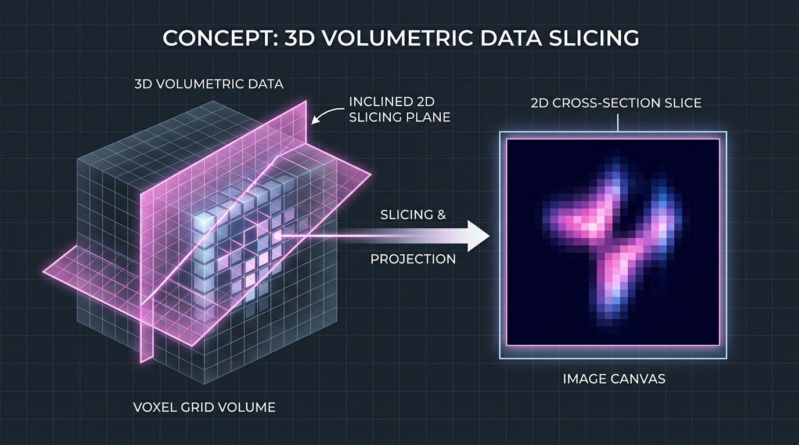
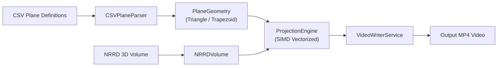

# System Architecture & Algorithm Design

## Project: 3D Volume Plane Projection (Ex1)

---

## 1. Concept & Problem Definition

The system extracts arbitrary 2D cross-sectional digital slices from 3D volumetric raster data (NRRD format) along user-defined cutting planes, and compiles them into a smooth, standardized MP4 video sequence.

<div align="center">
  
  <p><em>Figure 1: Slicing through a 3D volumetric raster along an arbitrary cutting plane to project a 2D cross-section.</em></p>
</div>

---

## 2. System Architecture

The software follows Object-Oriented Design (OOD) principles, dividing responsibilities into decoupled components:



### Core Modules:

1. **Geometry (`src.geometry`):**
   * `Point3D` and `Vector3D`: Immutable 3D spatial primitives with operator overloading (`+`, `-`, scalar multiplication, dot and cross products).
   * `PlaneGeometry` (Abstract Base Class): Defines the unified slicing contract.
   * `IsoscelesTrianglePlane` and `IsoscelesTrapezoidPlane`: Geometric validation, endpoint calculation, and canvas dimensioning.
   * `InvalidPlane`: Fallback representation for malformed or degenerate inputs.

2. **Volume I/O (`src.io.nrrd_loader`):**
   * `NRRDVolume`: Loads volumetric raster arrays across 8, 16, and 32-bit integer formats, with fast coordinate sampling.

3. **Projection Engine (`src.engine.slicer`):**
   * `ProjectionEngine`: Core vectorized algorithm that samples continuous 3D spatial coordinates and maps them into a centered 2D pixel matrix.

4. **Video Service (`src.io.video_writer`):**
   * `VideoWriterService`: Manages H.264/MPEG-4 video encoding, uniform canvas centering, even-dimension enforcement, and memory-safe O(1) buffer streaming.

---

## 3. The Planar Slicing Algorithm

### 3.1 Geometric Validation & Dimensions

Every cutting plane is validated against geometric constraints using an epsilon tolerance of 0.001:

* **Isosceles Triangle (3 points: a, b, c):**
  * Leg equality: `|dist(a, b) - dist(a, c)| < 0.001`
  * Slice Height: `D_height = ceil(dist(a, b))`
  * Slice Width: `D_width = ceil(dist(b, c))`

* **Isosceles Trapezoid (4 points: a1, a2, b, c):**
  * Leg equality: `|dist(a1, b) - dist(a2, c)| < 0.001`
  * Base width ordering: `dist(a1, a2) <= dist(b, c)`
  * Coplanarity: Absolute scalar triple product `|( (a2 - a1) × (b - a1) ) • (c - a1)| < 0.001`
  * Slice Height: `D_height = ceil(dist(a1, b))`
  * Slice Width: `D_width = ceil(dist(b, c))`

---

### 3.2 Scanline Progression & Horizontal Centering

The slice is generated row-by-row along discrete scanlines `y = 0, 1, ..., D_height - 1`:

1. **Endpoint Interpolation:**
   For each row `y`, endpoints move down the legs:
   * Triangle: `p_start(y) = a + y * unit_vector(a -> b)` and `p_end(y) = a + y * unit_vector(a -> c)`
   * Trapezoid: `p_start(y) = a1 + y * unit_vector(a1 -> b)` and `p_end(y) = a2 + y * unit_vector(a2 -> c)`

2. **Active Scanline Width & Sampling Vector:**
   * Scanline width: `d12 = dist(p_start(y), p_end(y))`
   * Spatial unit step vector: `dp = (p_end(y) - p_start(y)) / d12`

3. **Symmetric Horizontal Centering:**
   To preserve the correct geometric shape without horizontal stretching, shorter rows near the top are horizontally centered inside the rectangular bounding frame:
   * Horizontal offset: `x_offset = floor((D_width - d12) / 2)`
   * Row sample `x1` maps to image column: `x = x_offset + x1`
   * Areas outside the active scanline remain zero-padded (`v = 0`).

4. **Nearest-Neighbor Discretization & Out-of-Bounds (OOB) Rule:**
   * Continuous 3D coordinates are mapped to discrete voxel indices using nearest-neighbor rounding:
     `voxel_index = round(P(y, x))`
   * If any coordinate falls outside the volume dimensions `[0..sx-1, 0..sy-1, 0..sz-1]`, its value defaults strictly to `0`.

---

## 4. Performance Optimization: SIMD Vectorization

### The Naive Loop Bottleneck:
A typical 500 × 500 slice contains 250,000 pixels. Implementing nested Python loops:
```python
# SLOW: Pure Python interpretation (~0.5 FPS, ~2.0 seconds per frame)
for y in range(D_height):
    for x1 in range(int(d12)):
        p = p_start + x1 * dp
        val = sample_volume_oob(volume, p)
        image[y, x_offset + x1] = val
```
This naive approach fails the course requirement of 30+ FPS.

### The Vectorized NumPy Solution:
The projection engine replaces Python inner loops with vectorized 2D array broadcasting:
1. Row coordinate generation is calculated across the entire scanline at once using SIMD vector instructions.
2. Nearest-neighbor rounding is applied in compiled C via `np.rint()`.
3. Out-of-bounds coordinates are filtered using a branchless boolean mask.
4. Valid voxels are fetched using direct memory buffer indexing.

**Result:** Computation time drops from 2,000 ms to **3.7–4.5 ms per frame**, delivering **230–260+ FPS** on standard datasets and **73+ FPS** on the massive 500 × 500 × 500 benchmark volume.

---

## 5. Video Generation: The Two-Pass Pipeline

Standard video encoders (H.264 / MPEG-4) enforce two container constraints:
1. **Uniform Dimensions:** Every frame in the MP4 file must have the exact same width and height.
2. **Even Dimensions:** Video encoders require both width and height to be even numbers (divisible by 2) for chroma subsampling. Odd dimensions cause encoder failure.

To satisfy these constraints with minimal memory usage, the system uses a **Two-Pass Architecture**:

* **Pass 1 — Uniform Canvas Determination:**
  Scans all cutting planes in the CSV to determine the maximum slice width (`max_w`) and height (`max_h`). If either dimension is odd, it is incremented by 1 to guarantee an even canvas size.

* **Pass 2 — Frame Slicing & Direct Streaming:**
  Slices each plane using the SIMD engine, linearly normalizes intensity to `[0, 255]`, centers the slice onto the uniform canvas, and writes the frame directly to the MP4 container.

### Memory Efficiency:
Frames are written directly to the video container one by one. The system operates with **O(1) working memory**, preventing out-of-memory errors on long sequences.

---

## 6. Fault Tolerance & Error Handling

The engine handles invalid inputs gracefully without aborting execution:

1. **Non-Numeric or Corrupted Rows:** Format errors (such as `"abc"`, incomplete coordinates, or `"inf"`) are logged as diagnostic warnings and produce an all-zero black frame.
2. **Degenerate Geometries:** Collinear points, non-coplanar quads, or non-isosceles planes log a warning and output a black frame.
3. **Oversized Dimensions:** Planes with dimensions exceeding standard video encoder limits (> 4096) are safely constrained and rendered as black frames.
4. **Stream Continuity:** The frame count in the output MP4 strictly matches the number of plane specifications in the CSV, preserving audio/video synchronization.
