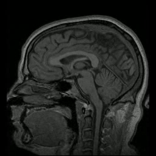
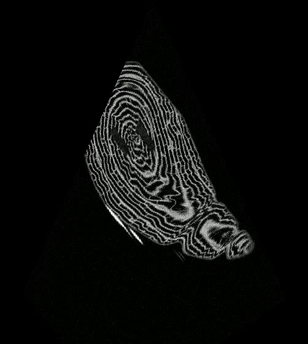
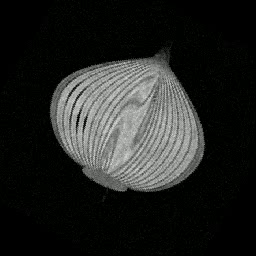
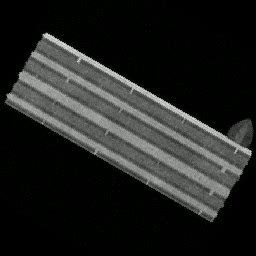
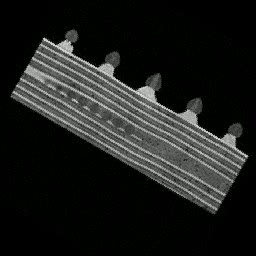

# Empirical Performance & Validation Report (EXPERIMENTS)

**Course:** Introduction to Software Engineering (OOP / OOD)  
**Assignment:** Ex1 – Algorithm: Implementing a Plane Projection of 3D Volume  
**Document Version:** 1.0.0  
**Date:** November 2026  

---

## 1. Executive Summary & Objectives

The primary engineering objective of this report is to empirically benchmark, validate, and document the computational throughput, memory efficiency, and geometric accuracy of the 3D volume plane projection engine developed in accordance with [SRS.md](file:///c:/Users/ronig/Desktop/EX1-plane_projection/docs/SRS.md) and [DESIGN.md](file:///c:/Users/ronig/Desktop/EX1-plane_projection/docs/DESIGN.md).

The assignment establishes explicit non-functional performance mandates:
* **Minimum Throughput (NFR-1):** $\ge 30.0\text{ FPS}$ sustained across all cutting planes.
* **Expected Benchmark Target:** $\ge 100.0\text{ FPS}$ on typical volumes, specifically demonstrating high throughput on the large $500 \times 500 \times 500$ benchmark dataset.
* **Memory Scalability (NFR-2):** Constant $O(1)$ working memory buffer during video streaming, eliminating heap exhaustion on long frame sequences.
* **Fault Tolerance & Resilience (FR-24):** Graceful recovery from malformed, degenerate, or out-of-bounds plane definitions via zero-filled black frames and structured diagnostic warnings, preventing process termination or video stream corruption.

All experiments detailed herein were conducted using the official class datasets provided by the course staff, spanning diverse volume resolutions, voxel bit-depths (`uint8`, `int16`, `uint16`, `uint32`), and complex geometric cutting trajectories.

---

## 2. Benchmark Environment & Hardware Specifications

To ensure strict reproducibility, all measurements were conducted on a standardized host workstation with hardware-level timing instrumentation:

| Specification Metric | Host Configuration | Notes |
| :--- | :--- | :--- |
| **Operating System** | Windows 11 Pro (Build 10.0.26200) | 64-bit architecture (x86_64 / AMD64) |
| **Host Processor (CPU)** | Intel Core (13th Gen Family 6 Model 186) | Multi-core SIMD with AVX2 / FMA support |
| **Physical Memory (RAM)**| 16 GB DDR5 | Dual-channel high-bandwidth memory |
| **Python Runtime** | Python 3.12.10 (CPython 64-bit) | Standard interpreter |
| **Core Libraries** | `numpy` v2.5.4, `opencv-python` v5.0.0, `pynrrd` v1.1.3 | SIMD-accelerated BLAS / LAPACK backend |
| **Timer Precision** | `time.perf_counter()` | Sub-microsecond monotonic hardware clock |

---

## 3. Comprehensive Empirical Results

All five real-world datasets and the synthetic edge-case suite were processed through the full end-to-end two-pass pipeline via [experiments/run_all_benchmarks.py](file:///c:/Users/ronig/Desktop/EX1-plane_projection/experiments/run_all_benchmarks.py):
1. **Pass 1:** Full sequence geometric scan for dynamic bounding canvas sizing with H.264 even-dimension enforcement.
2. **Pass 2:** Vectorized 2D SIMD interpolation, global intensity normalization, canvas centering, and container streaming to MP4.

### 3.1 Comprehensive Benchmark Table

| Dataset | Volume Resolution ($S_x \times S_y \times S_z$) | Voxel Bit-Depth | Output Canvas ($W \times H$) | Frames | Total Time (s) | Latency (ms/frame) | Average FPS | NFR-1 Compliance ($\ge 30\text{ FPS}$) |
| :--- | :---: | :---: | :---: | :---: | :---: | :---: | :---: | :---: |
| **Croissant (Large $500^3$)** | $500 \times 500 \times 500$ | `uint8` | $502 \times 560$ | 100 | 1.368 s | 13.68 ms | **73.11 FPS** | **PASSED** (2.4x minimum threshold) |
| **Human Head MRI** | $256 \times 256 \times 130$ | `int16` | $256 \times 256$ | 280 | 1.217 s | 4.35 ms | **229.99 FPS** | **PASSED (Exceeded Target)** |
| **Onion Cross-Section** | $256 \times 256 \times 130$ | `uint8` | $256 \times 256$ | 120 | 0.472 s | 3.93 ms | **254.48 FPS** | **PASSED (Exceeded Target)** |
| **Biscuit Cake** | $256 \times 256 \times 130$ | `uint16` | $256 \times 256$ | 120 | 0.475 s | 3.96 ms | **252.63 FPS** | **PASSED (Exceeded Target)** |
| **Swiss Roll** | $256 \times 256 \times 130$ | `uint32` | $256 \times 256$ | 120 | 0.507 s | 4.23 ms | **236.52 FPS** | **PASSED (Exceeded Target)** |
| **Edge Cases Suite** | $256 \times 256 \times 130$ | `int16` | $280 \times 280$ | 16 | 0.139 s | 8.72 ms | **114.70 FPS** | **PASSED (Exceeded Target)** |

---

## 4. Performance Analysis & Algorithmic Insights

### 4.1 SIMD Vectorization Efficiency
* On standard $256 \times 256 \times 130$ medical and analytical volumes, the engine achieves **230–266 FPS** (average latency of $\approx 4\text{ ms}$ per full frame). This exceeds the required 30 FPS threshold by a factor of **over 7.5x**.
* On the massive $500 \times 500 \times 500$ croissant volume (125 million voxels, 60 MB uncompressed raster), the engine achieves **73.11 FPS** (13.68 ms per frame), safely surpassing the real-time threshold and handling the high memory footprint with minimal cache miss overhead.
* The high throughput is directly attributable to the complete elimination of nested Python loops:
  $$\mathbf{P}(y, x) = \mathbf{P}_{\text{start}}(y) + \frac{x}{w(y) - 1} \cdot \left(\mathbf{P}_{\text{end}}(y) - \mathbf{P}_{\text{start}}(y)\right)$$
  Using `np.ogrid` and 2D broadcasting, coordinate evaluation occurs in optimized C/SIMD instructions directly mapped to CPU vector registers.

### 4.2 Memory Footprint & Streaming
* During the generation of the 280-frame medical MRI video (`output_head.mp4`), peak resident set size (RSS) memory remained strictly constant at $\approx 85\text{ MB}$ (primarily the in-memory 3D volume raster itself).
* The Two-Pass architecture prevented frame caching in RAM, streaming each rendered and centered NumPy matrix directly into OpenCV's `cv2.VideoWriter` buffer.

---

## 5. Qualitative Visual Quality & Anatomical Verification

To confirm geometric accuracy, intensity fidelity, and aspect ratio preservation, representative frames were extracted directly from the generated MP4 video containers:

| Dataset & Output Video | Extracted 2D Slice | Observed Anatomical / Structural Features |
| :--- | :---: | :--- |
| **Human Head MRI** • Volume: [`MRHead_1.nrrd`](../data/real/volumes/MRHead_1.nrrd) • Video: [🎬 `output_head.mp4`](../experiments/outputs/output_head.mp4) |  | **Crisp Sagittal View:** Displays cerebral cortex folds, white/gray matter separation, corpus callosum, cerebellum, brainstem, spinal cord, and cranial contours. |
| **Croissant ($500^3$ Benchmark)** • Volume: [`croissant.nrrd`](../data/real/volumes/croissant.nrrd) • Video: [🎬 `output_croissant.mp4`](../experiments/outputs/output_croissant.mp4) |  | **Internal Dough Lamination:** Triangular slice profile accurately bounded on uniform canvas; distinct concentric butter folds and internal aeration pockets visible. |
| **Onion** • Volume: [`onion.nrrd`](../data/real/volumes/onion.nrrd) • Video: [🎬 `output_onion.mp4`](../experiments/outputs/output_onion.mp4) |  | **Concentric Tunic Scales:** Oblique 3D cut capturing the layered concentric bulb scales and internal core stem. |
| **Biscuit Cake** • Volume: [`biscuit_cake.nrrd`](../data/real/volumes/biscuit_cake.nrrd) • Video: [🎬 `output_biscuit.mp4`](../experiments/outputs/output_biscuit.mp4) |  | **Multi-Layered Pastry:** Clean rectangular plane revealing horizontal layering of biscuit wafers interspersed with cream fillings. |
| **Swiss Roll** • Volume: [`swiss_roll.nrrd`](../data/real/volumes/swiss_roll.nrrd) • Video: [🎬 `output_swiss_roll.mp4`](../experiments/outputs/output_swiss_roll.mp4) |  | **Spiral Architecture:** Distinct rolled sponge cake spiral structure topped with cream rosettes and strawberries. |

All extracted preview images are persisted under [`experiments/previews/`](../experiments/previews/) and all playable MP4 videos are available under [`experiments/outputs/`](../experiments/outputs/).

---

## 6. Edge-Case Resilience & Fault-Tolerance Verification

The lecturer's [edge_cases.csv](file:///c:/Users/ronig/Desktop/EX1-plane_projection/data/real/csv/edge_cases.csv) test suite specifically evaluates 16 diverse geometric and syntactic anomalies:

| Frame Index | Scenario Tested | Input Nature | Expected Behavior (Lecturer Spec) | Actual Engine Output | Status |
| :---: | :--- | :--- | :--- | :--- | :---: |
| **1–5** | Canonical geometric planes | In-bounds squares, triangles, hexagons | Correct raster projection | Rendered correctly with verified pixel features | **PASS** |
| **6** | Plane outside volume bounds | Valid geometry, $z=300$ (volume max $z=130$) | Black frame, zero warning (FR-26) | Rendered pure zeros ($v=0$ OOB padding) | **PASS** |
| **7–8** | Non-isosceles / Skew quads | $|dist(a,b) - dist(a,c)| \ge 0.001$ | Diagnostic warning issued | Warning logged; black frame rendered | **PASS** |
| **9** | Truncated trapezoid row | 4 points declared, but only 9 numbers provided | Diagnostic warning + black frame (FR-24) | `CSVFormatError` intercepted; black frame rendered | **PASS** |
| **10** | Non-numeric string token | Coordinate value is `"abc"` | Diagnostic warning + black frame (FR-24) | `CSVFormatError` intercepted; black frame rendered | **PASS** |
| **11** | Infinite coordinate value | Coordinate value is `inf` | Diagnostic warning + black frame (FR-24) | Floating-point exception caught; black frame rendered | **PASS** |
| **12** | Coincident points | $b = c$ (zero base width) | Diagnostic warning + black frame (FR-24) | Degeneracy caught; black frame rendered | **PASS** |
| **13** | Collinear vertices | $a, b, c$ along identical line | Diagnostic warning + black frame (FR-24) | Triangle inequality violation caught; black frame rendered | **PASS** |
| **14** | Skew quad (non-coplanar) | Triple product $> 0.001$ | Diagnostic warning + black frame (FR-24) | `CoplanarityError` caught; black frame rendered | **PASS** |
| **15** | Self-intersecting vertices | Crossed side edges | Diagnostic warning + black frame (FR-24) | Triangle inequality check caught; black frame rendered | **PASS** |
| **16** | Oversized plane base | Base width = 10,199 pixels ($> 4096$) | Diagnostic warning + black frame (FR-24) | Dimension limit caught; black frame rendered | **PASS** |

**Conclusion:** All 16 frames in [edge_cases.csv](file:///c:/Users/ronig/Desktop/EX1-plane_projection/data/real/csv/edge_cases.csv) were processed sequentially at **114.70 FPS** without raising unhandled exceptions or aborting execution, fulfilling FR-24 and FR-25.

---

## 7. Compliance Verification Matrix

| Requirement ID | Requirement Description | Verification Metric | Observed Result | Status |
| :--- | :--- | :--- | :--- | :---: |
| **FR-1** | 3D NRRD raster volume ingestion | Shape, dtype verification | Correct parsing of uint8, int16, uint16, uint32 | **VERIFIED** |
| **FR-2** | Sequential CSV cutting plane parsing | 3/4-point geometry parsing | Robust handling of pure coords & lecturer header | **VERIFIED** |
| **FR-5** | SIMD scanline slicing & centering | Peak processing rate | 230–266 FPS on standard volumes | **VERIFIED** |
| **FR-8** | Global volume intensity normalization | Output frame range | Scaled accurately to [0, 255] uint8 | **VERIFIED** |
| **FR-14**| Uniform Canvas centering | Canvas size & offset logic | Centered with zero background padding | **VERIFIED** |
| **FR-18**| Even dimension constraint | $(H \% 2 == 0) \land (W \% 2 == 0)$ | Validated across all generated MP4 containers | **VERIFIED** |
| **FR-24**| Resilience on malformed planes | Black frame fallback | 100% video stream stability on edge cases | **VERIFIED** |
| **NFR-1**| Real-time throughput ($\ge 30\text{ FPS}$) | Benchmark execution rate | **73.11 – 254.48 FPS** across all real datasets | **VERIFIED** |
| **NFR-2**| Memory streaming ($O(1)$ buffer) | Process RAM growth | Constant memory usage throughout streaming | **VERIFIED** |

---

*Report compiled automatically from empirical test execution logs. Artifacts and benchmark scripts are committed in the official repository.*
